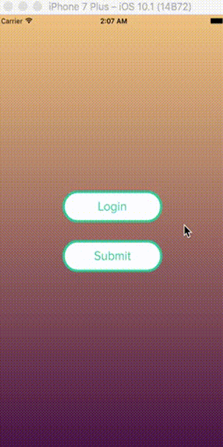

# react-native-submit-button

An animated submit button for React Native. It folds into a progress ring while your request runs, then unfolds into a success or error state.



Inspired by [this Dribbble shot](https://dribbble.com/shots/1426764-Submit-Button).

- **Reanimated 4**: every animation runs on the UI thread
- **New Architecture** (Fabric) ready; no native code of its own
- **TypeScript** types included
- **Promise-driven**: return a promise from `onPress` and the button handles loading, success and error on its own
- **Controlled mode** when you need to drive it yourself
- SVG icons and spinner (no icon font), accessibility roles and busy state, Reduce Motion aware

## Installation

```sh
npm install react-native-submit-button react-native-reanimated react-native-worklets react-native-svg
```

With Expo:

```sh
npx expo install react-native-submit-button react-native-reanimated react-native-worklets react-native-svg
```

Reanimated 4 needs the New Architecture and its Babel plugin. Expo adds the plugin for you. In a bare React Native app, add it last in `babel.config.js`:

```js
module.exports = {
  presets: ['module:@react-native/babel-preset'],
  plugins: ['react-native-worklets/plugin']
}
```

## Usage

### Let a promise drive it

```tsx
import { SubmitButton } from 'react-native-submit-button'

export function PayButton() {
  return (
    <SubmitButton
      title="Pay $25"
      errorTitle="Declined"
      onPress={() => api.pay()} // resolves → success, rejects → error
      onSuccess={() => navigation.goBack()}
      resetAfter={2000} // back to idle after 2 s (optional)
    />
  )
}
```

### Control it yourself

```tsx
const [status, setStatus] = useState<SubmitButtonStatus>('idle')

<SubmitButton
  status={status}
  onPress={async () => {
    setStatus('loading')
    try {
      await save()
      setStatus('success')
    } catch {
      setStatus('error')
    }
  }}
/>
```

When `status` is set, the button never changes state by itself.

## Props

| Prop | Type | Default | Description |
|---|---|---|---|
| `onPress` | `() => unknown` | | Called on press. Return a promise to let the button show loading, then success or error. Ignored while busy. |
| `status` | `'idle' \| 'loading' \| 'success' \| 'error'` | | Controlled state. Leave unset for the promise-driven mode. |
| `title` | `string` | `'Submit'` | Label in the idle state. |
| `successTitle` | `string` | | Label after success. Without it, a check mark is shown. |
| `errorTitle` | `string` | | Label after an error. Without it, a cross is shown. |
| `successIcon` | `ReactNode` | check mark | Custom success icon. |
| `errorIcon` | `ReactNode` | cross | Custom error icon. |
| `width` | `number` | `180` | Width when unfolded. |
| `height` | `number` | `54` | Height; also the diameter of the spinner. |
| `color` | `string` | `'#1ECD97'` | Border, text, spinner and success fill. |
| `backgroundColor` | `string` | `'#FFFFFF'` | Idle fill; text and icon colour on success or error. |
| `errorColor` | `string` | `'#FF6666'` | Error fill. |
| `trackColor` | `string` | `'#BBBBBB'` | Spinner track. |
| `borderWidth` | `number` | `4` | Border and spinner stroke width. |
| `duration` | `number` | `250` | Fold and unfold time in ms. |
| `resetAfter` | `number` | | Promise-driven mode only: return to idle this many ms after the result. |
| `disabled` | `boolean` | `false` | Disables presses and dims the button. |
| `onSuccess` | `() => void` | | Fires once the success state has unfolded. |
| `onError` | `() => void` | | Fires once the error state has unfolded. |
| `style` | `ViewStyle` | | Outer container style (margins, alignment). |
| `textStyle` | `TextStyle` | | Label style. |
| `accessibilityLabel` | `string` | `title` | Screen reader label. |
| `accessibilityHint` | `string` | | Screen reader hint. |
| `testID` | `string` | | Test ID of the container; the pressable gets `${testID}-pressable`. |

## Migrating from 1.x

Version 2 is a rewrite. It drops `react-native-vector-icons` and `react-native-circular-progress`, and needs Reanimated 4, Worklets and SVG instead.

| 1.x | 2.x |
|---|---|
| `buttonState="normal"` | `status="idle"` |
| `buttonState="success" \| "error"` | `status="success" \| "error"` |
| (loading started on press) | `status="loading"`, or return a promise from `onPress` |
| `onSubmit` | `onPress` |
| `buttonText` | `title` |
| `buttonTextWhenReady` | `successTitle` / `errorTitle` |
| `iconName` (FontAwesome) | `successIcon` / `errorIcon` (any element) |
| `primaryColor` | `color` |
| `secondaryColor` | `backgroundColor` |
| `animationDuration` | `duration` |
| `buttonStyle` | `style` |
| `module.exports` | `import { SubmitButton }` or the default export |

## Example app

```sh
git clone https://github.com/ronak301/react-native-submit-button.git
cd react-native-submit-button && npm install
cd example && npm install
npx expo run:ios   # or: npx expo run:android
```

## License

[MIT](LICENSE.txt) © Ronak Kothari
